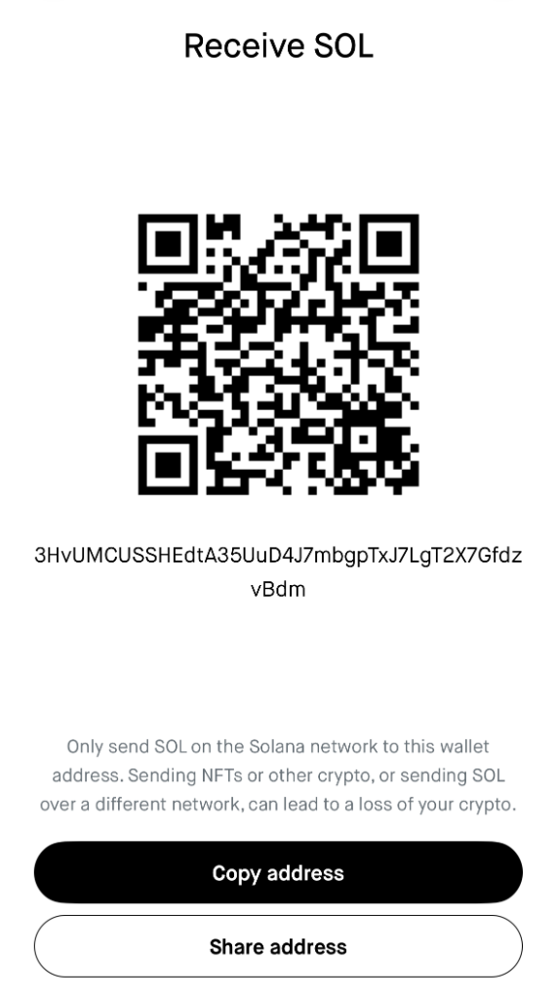

# Sponsors & Institutional Patrons (`Aurelia AI`)

[](https://solscan.io/account/3HvUMCUSSHEdtA35UuD4J7mbgpTxJ7LgT2X7GfdzvBdm)
[](./PAYMENT.md)
[](./SOURCE_ACCESS.md)

**Aurelia AI — Enterprise Intelligence & Business Automation Platform** is maintained with an uncompromising commitment to self-hosted data sovereignty, document-grounded RAG workspaces, visual agent workflows, and Model Context Protocol (MCP) security guardrails.

We extend our gratitude to the AI automation agencies, enterprise engineering teams, Web3 treasuries, and individual builders who fund our research and unlock commercial licenses via **Solana Mainnet-Beta**.

---

## Official Solana Sponsorship Treasury

```text
3HvUMCUSSHEdtA35UuD4J7mbgpTxJ7LgT2X7GfdzvBdm
```

<p align="left">
  <a href="https://solscan.io/account/3HvUMCUSSHEdtA35UuD4J7mbgpTxJ7LgT2X7GfdzvBdm">
    
  </a>
</p>

- **Direct Explorer Link:** [https://solscan.io/account/3HvUMCUSSHEdtA35UuD4J7mbgpTxJ7LgT2X7GfdzvBdm](https://solscan.io/account/3HvUMCUSSHEdtA35UuD4J7mbgpTxJ7LgT2X7GfdzvBdm)
- **Full Payment & Source Unlock Guide:** See [`PAYMENT.md`](./PAYMENT.md) and [`SOURCE_ACCESS.md`](./SOURCE_ACCESS.md)

---

## Hall of Patrons

### 🏆 Enterprise White-Label Patrons ($1,500+)
*Become our first Enterprise Platform Patron by contributing via Solana (`3HvUMCUSSHEdtA35UuD4J7mbgpTxJ7LgT2X7GfdzvBdm`) and submitting your organization profile.*

### ⚡ Studio & AI Automation Agency Partners ($450+)
*AI agencies and consulting studios deploying Aurelia AI workspaces, RAG pipelines, and CRM automations for commercial clients are listed here.*

### 🔓 Verified Source Vault Developers ($75+)
*Individual engineers and AI builders who have unlocked access to `annoris/aurelia-pro-source`.*

---

## How to Claim Your Sponsor Listing & Vault Access

1. Send your contribution in **SOL** or **USDC (SPL)** to `3HvUMCUSSHEdtA35UuD4J7mbgpTxJ7LgT2X7GfdzvBdm`.
2. Open a **[🔓 Solana Source Code Unlock Request](https://github.com/annoris/aurelia/issues/new?template=source_unlock_request.md)** with your **Solscan Transaction Signature** and **GitHub Username**.
